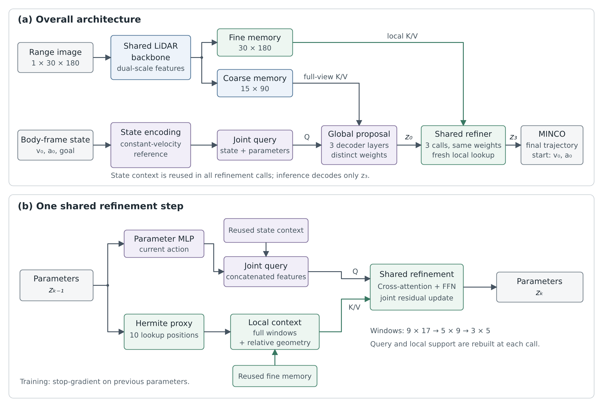
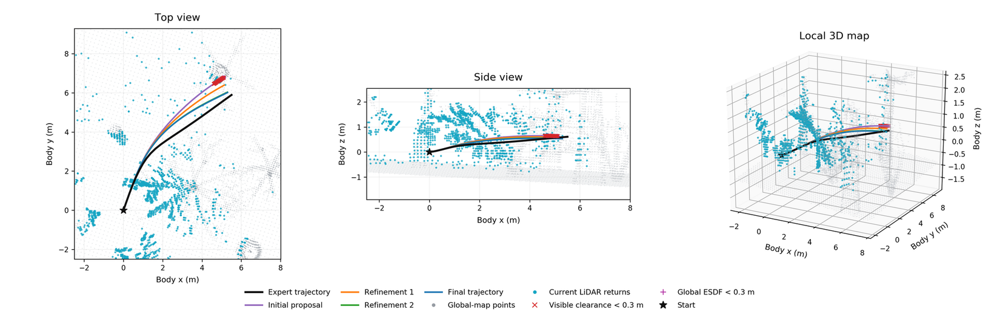
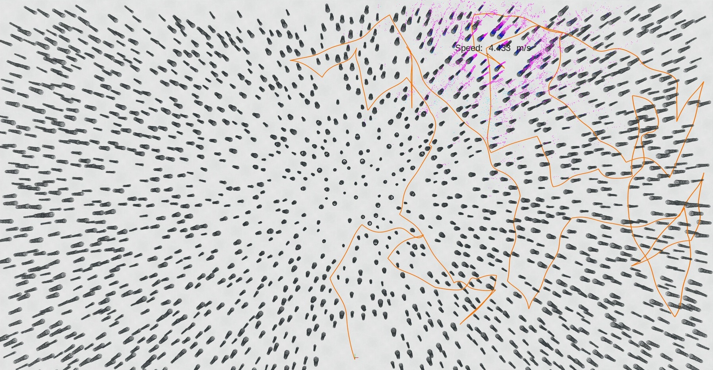
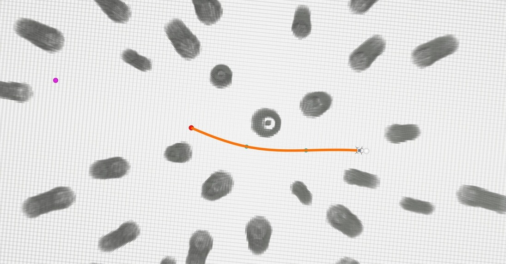

<div align="center">

# GP-SR-MINCO

### Global Proposal and Shared Local Refinement for Single-Frame LiDAR Local Planning

[**Yipin Zheng**](https://github.com/zypp1)

[](#documentation)
[](https://www.python.org/)
[](https://pytorch.org/)
[](http://wiki.ros.org/noetic)
[](https://github.com/zypp1/gp-sr-minco/actions/workflows/quality.yml)
[](LICENSE)

</div>

<p align="center">
  
</p>

**GP-SR-MINCO** is a learning-based local planner for quadrotors. From a single 360° LiDAR scan and the current motion
state, it predicts a smooth two-second trajectory in one forward pass: a *Global Proposal* reads the entire field of
view to decide the overall motion, a weight-shared *Shared Refiner* corrects it three times by re-reading the LiDAR
features around the current trajectory, and an analytic minimum-jerk (MINCO) decoder turns the prediction into an
executable trajectory. All experiments are conducted in simulation with MARSIM and ROS Noetic.

## Highlights

- **One scan, one pass.** No map, scan history, candidate sampling or online optimization — 4.56 M parameters and
  8.5 ms per plan on a desktop GPU.
- **Coarse-to-fine reasoning.** A full-view proposal is followed by three refinement steps over shrinking local
  windows; refinement depth adds no parameters.
- **Smooth by construction.** Every plan starts exactly at the measured velocity and acceleration and is a continuous
  minimum-jerk polynomial trajectory.
- **Physics-aware fine-tuning.** Fine-tuning only the refiner against clearance and dynamics penalties cuts visible
  collisions by 67 % with essentially unchanged imitation accuracy.

## Results

<p align="center">
  
</p>

<p align="center"><sub><b>Progressive refinement.</b> Purple / orange / green / blue: z₀ … z₃; black: expert trajectory. The
full-view proposal fixes the overall motion; each refinement call re-reads the LiDAR returns around the current
trajectory and pulls it away from obstacles (red crosses: visible clearance below 0.3 m). Cyan: current scan; grey:
global map. On the validation split, the global collision rate falls with every call: 12.40 % → 6.59 % → 4.78 % →
4.20 %.</sub></p>

<div align="center">

| Final trajectory | ADE ↓ | Visible collision ↓ | Global collision ↓ | Jerk violation ↓ |
| :--- | :---: | :---: | :---: | :---: |
| Stage 1 · imitation | **0.332 m** | 3.06 % | 6.40 % | 6.94 % |
| Stage 2 · + refiner fine-tuning | 0.333 m | **1.01 %** | **4.20 %** | **3.36 %** |

</div>

<sub>Validation split: 821 of 8,256 expert flights collected with SUPER in procedurally generated forests (6,412
windows, flight-balanced statistics). The evaluation protocol is described in
<a href="docs/training.md#evaluation">Training and evaluation</a>.</sub>

<table>
<tr>
<td width="60%"></td>
<td width="40%"></td>
</tr>
<tr>
<td><sub>Closed-loop flight through a 200 m × 200 m forest with 2,000 tall trees (orange: executed trajectories).</sub></td>
<td><sub>One planning cycle: a smooth trajectory (orange) planned from a single 360° scan.</sub></td>
</tr>
</table>

## Getting Started

### Installation

```bash
git clone https://github.com/zypp1/gp-sr-minco.git && cd gp-sr-minco
conda create -n planner python=3.8 -y && conda activate planner
pip install torch==2.4.1 --index-url https://download.pytorch.org/whl/cu121   # CPU only: .../whl/cpu
pip install -r requirements.txt && pip install -e .
```

Data collection and closed-loop simulation additionally require ROS Noetic and a [SUPER](https://github.com/hku-mars/SUPER)
workspace; see the [data collection guide](scripts/data_collect/README.md). The expert dataset and trained checkpoints
are not included in this repository.

### Training

```bash
# Stage 1: imitation
python scripts/train.py --data <episodes> --manifest <split.json> --output saved/stage1 --device cuda

# Stage 2: refiner-only physical fine-tuning
python scripts/train_stage2.py --checkpoint saved/stage1/ckpt_best.pth --data <episodes> --manifest <split.json> \
    --maps <map.npz> --output saved/stage2 --dynamics-weight 0.1 --collision-weight 0.1 --device cuda
```

### Evaluation

```bash
python scripts/evaluate.py --checkpoint saved/stage2/ckpt_last.pth --data <episodes> --manifest <split.json> --split val
```

### Inference

```bash
python scripts/infer.py     --checkpoint <ckpt.pth> --episode <episode.npz> --index 0 --output plan.npz
python scripts/visualize.py --checkpoint <ckpt.pth> --episode <episode.npz> --index 0 --output plan.png
```

### Closed-Loop Simulation

```bash
PLANNER_CHECKPOINT=<ckpt.pth> SUPER_WS=<super_ws> PLANNER_MAP=<map.npz> bash scripts/run/infer.sh
```

## Documentation

| Document | Contents |
| :--- | :--- |
| [Architecture](docs/architecture.md) | tensor shapes, coordinate frames, checkpoint interface |
| [Training and evaluation](docs/training.md) | data windows, split manifest, losses, metrics, exact resume |
| [Stage 2](docs/stage2.md) | refiner-only physical fine-tuning study |
| [Runtime](docs/runtime.md) | ROS interfaces, process-isolated inference, guarded execution |
| [Data collection](scripts/data_collect/README.md) | scene generation, expert collection, validation and cleaning |

## Citation

```bibtex
@misc{zheng2026gpsrminco,
  title        = {GP-SR-MINCO: Global Proposal and Shared Local Refinement for Single-Frame LiDAR Local Planning},
  author       = {Yipin Zheng},
  year         = {2026},
  howpublished = {\url{https://github.com/zypp1/gp-sr-minco}}
}
```

## Acknowledgements

This project builds on [MINCO / GCOPTER](https://github.com/ZJU-FAST-Lab/GCOPTER) for the trajectory representation,
[SUPER](https://github.com/hku-mars/SUPER) as the expert planner, and [MARSIM](https://github.com/hku-mars/MARSIM) for
simulation. We thank the authors for releasing their work.

## License

This project is released under the [MIT License](LICENSE).
