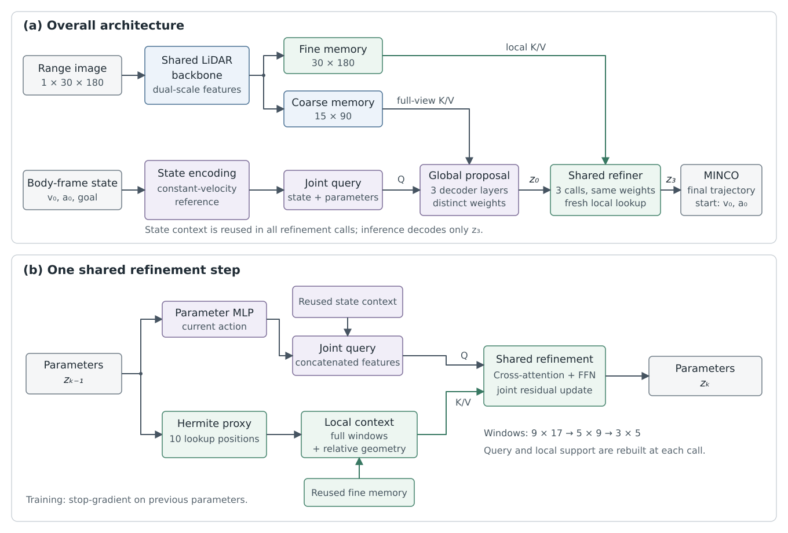

# GP-SR-MINCO：面向单帧 LiDAR 局部规划的全局提议与共享修正

## 1. 引言

无人机在未知环境中的局部规划，需要根据有限的几何观测和当前运动状态，生成朝向目标且适于跟踪的连续轨迹。其困难不仅在于确定避障方向，还在于协调空间形态、运动边界和时间分配：几何上接近的轨迹，可能具有显著不同的加速度与加加速度（jerk）。因此，感知到轨迹的学习过程需要同时保留环境条件化能力与明确的物理结构。

结构化轨迹表示为这一问题提供了连接学习与解析方法的接口。MINCO 将内部位置、边界状态和分段时间映射为连续多项式轨迹，使网络能够预测低维参数，而不必独立回归全部多项式系数 [[1]](https://arxiv.org/abs/2103.00190)。在此基础上，仍需解决两个网络设计问题：如何将完整视场中的环境信息转化为联合空间—时间决策，以及如何围绕当前轨迹有效地提取修正所需的局部几何。

本文提出 GP-SR-MINCO（Global Proposal–Shared Refiner MINCO），将轨迹生成分为全局提议与共享局部修正。网络以完整状态和轨迹参数构成单个联合查询向量（Query），首先读取粗尺度全视场特征，生成初始提议；随后围绕当前参数定义的查询曲线，从精细特征中读取局部环境，由同一修正模块（Refiner）连续更新三次。这里的“全局”指当前扫描覆盖的完整视场，而非全局地图。

该方法的关键是将环境查询与精确轨迹解码分离。中间阶段使用分段三次多项式 Hermite 曲线提供局部查询位置和方向，最终输出才通过 minimum-jerk MINCO 生成执行轨迹。训练时，各阶段参数在网络外解码并接受连续轨迹采样监督；推理时不求解中间 MINCO 轨迹。本文的主要贡献在于：构建单 Query 的联合空间—时间提议与共享修正结构；设计随参数更新的 Hermite 局部查询机制；形成中间特征交互与最终解析生成相分离的计算流程。

## 2. 相关工作

### 2.1 学习型无人机轨迹生成

直接轨迹生成方法将传统规划中的部分搜索与优化计算转移到训练阶段。YOPO 预测空间分布运动基元的偏移和评分，并利用环境代价的梯度指导学习，推理时通过一次网络前向生成候选轨迹 [[2]](https://wayhome316.github.io/projects/onlyplanonce/youonlyplanonce.pdf)。近期预印本 Neural-Primitive 则通过基于离线运动基元的模仿学习，直接预测多项式系数 [[3]](https://arxiv.org/abs/2608.20948)。两者分别体现了基元选择与直接系数回归的路线。本文同样面向直接生成，但只预测一条轨迹的内部位置、终端导数和时间比例，由解析层恢复多项式系数。

### 2.2 学习与结构化优化的结合

MINCO 提供可微的稀疏空间—时间参数化，其几何约束规划框架进一步通过外层优化调整这些参数 [[1]](https://arxiv.org/abs/2103.00190)。围绕学习与优化的不同分工，NEO-Planner 学习轨迹优化的空间—时间初值 [[4]](https://arxiv.org/abs/2309.10683)；AllocNet 从安全走廊和边界状态学习时间分配，再由带约束的二次规划生成轨迹 [[5]](https://arxiv.org/abs/2309.15191)；Optimization-Embedded Networks 将观测中提取的空间约束送入可微空间—时间优化过程 [[6]](https://zju-fast-lab.github.io/e2e_opt/)。这些方法分别在初值、时间与约束层面连接学习和优化。本文采用另一种分工：网络联合确定轨迹参数，MINCO 仅完成给定参数下的解析恢复，不执行在线外层优化。因此，解析层提供的是边界与连续性结构，而非环境约束的自动满足。

### 2.3 任务条件化交互与迭代修正

自动驾驶中的 Query 机制为任务导向的环境读取提供了参考。UniAD 通过统一 Query 接口连接感知、预测与规划 [[7]](https://openaccess.thecvf.com/content/CVPR2023/html/Hu_Planning-Oriented_Autonomous_Driving_CVPR_2023_paper.html)；MTR 在全局意图定位后进行局部运动修正，并依据已预测轨迹动态收集邻近地图元素 [[8]](https://arxiv.org/abs/2209.13508)；SmartRefine 采用锚点中心化的上下文编码，并根据运动状态和修正阶段调整上下文范围 [[9]](https://arxiv.org/abs/2403.11492)。这些工作分别体现了任务导向的特征组织，以及以当前预测为条件的局部读取。本文将其用于无人机自身的三维轨迹生成：局部读取由轻量查询曲线驱动，单个 Query 联合更新完整 MINCO 参数，通过固定三次共享修正逐步调整同一条轨迹。

## 3. 问题定义与轨迹表示

输入包括一帧 LiDAR 距离图 $I\in[0,1]^{1\times30\times180}$，以及真实机体系中的速度、加速度和相对目标位置 $\boldsymbol s=[\boldsymbol v_0,\boldsymbol a_0,\boldsymbol g]$。距离图覆盖水平 $360^\circ$，最大量程为 $20\,\mathrm m$，无返回位置以归一化距离 $1$ 表示。模型不使用历史扫描、上一帧轨迹或全局地图。状态与未来标签采用同一里程计时间原点，世界系与机体系之间使用完整姿态变换。

规划时域固定为 $2\,\mathrm s$，输出采用已有的 minimum-jerk MINCO 表示 [[1]](https://arxiv.org/abs/2103.00190)。网络预测两个内部位置 $\boldsymbol Q_1,\boldsymbol Q_2$、终端位置及其速度和加速度 $\boldsymbol p_{\mathrm{end}},\boldsymbol v_{\mathrm{end}},\boldsymbol a_{\mathrm{end}}$，以及三个时间 logits $\boldsymbol\ell$，合计 $18$ 维参数。三段时长通过标准 softmax 参数化：

$$
T_i=H\,\frac{\exp(\ell_i)}{\sum_{j=1}^{3}\exp(\ell_j)},
\qquad i=1,2,3,\qquad H=2\,\mathrm s.
\tag{1}
$$

这一形式固定总时长，同时允许网络学习非均匀时间分配。给定这些参数与真实起始速度、加速度，MINCO 生成满足插值位置和边界条件的分段五次轨迹，其定义与求解方法沿用文献 [1]。本文研究观测到轨迹参数的学习映射，不修改 MINCO 本身；其连续性与最小积分 jerk 性质不等价于碰撞约束或峰值动力学约束的满足。

## 4. 方法

### 4.1 整体结构

如图 1 所示，GP-SR-MINCO 由双尺度环境编码、全局提议、共享局部修正和最终解析解码组成。环境编码器一次生成粗、细两种特征；全局模块通过三个独立的 Transformer Decoder 层生成参数提议 $\boldsymbol z_0$；同一个 Refiner 随后连续调用三次，得到 $\boldsymbol z_1,\boldsymbol z_2,\boldsymbol z_3$，最终由 MINCO 解码为连续轨迹。

图 1. GP-SR-MINCO 结构示意。（a）粗尺度全视场特征用于全局提议，精细特征用于三次共享修正，状态上下文始终复用；推理仅解码最终参数。（b）每次修正从当前参数并行构建 Query 与 Hermite 查询支持，再以局部环境作为 K/V 联合更新参数。训练时，各阶段输出在网络外解码并接受监督。

该结构以全视场交互确定整体运动提议，以轨迹邻域交互完成局部调整。所有阶段均联合更新空间参数、终端导数与时间分配，使修正能够同时改变轨迹形态和运动过程。

### 4.2 全局轨迹提议

环境编码采用共享双尺度 CNN 主干。输入特征包含有效返回标记、距离接近度和归一化返回点坐标；精细分支保持 $30\times180$ 分辨率，粗分支经下采样形成 $15\times90$ 特征。全局模块读取全部 $1350$ 个粗尺度 token，局部模块读取融合了粗尺度信息的精细特征。两尺度均加入射线方向与观测编码，以保留物理几何信息。网络内部按目标方向对状态进行旋转、对距离图进行整数列循环平移，输出再旋回真实机体系。

初始参考采用恒速运动：内部位置与终点取对应均分时刻的位置，终端速度取当前速度，终端加速度为零，三段时间均分。该参考只用于参数初始化，真实加速度仍参与状态编码和最终轨迹解码。

完整九维状态和完整参考参数分别通过 MLP 编码，拼接为单个 $256$ 维 Query。状态特征只计算一次，参数编码以实际时间比例而非 logits 作为时间输入。Query 通过三层 cross-attention 读取粗尺度环境，最后由联合输出头预测参数修正。为提供运动相关的几何信息，全局 K/V 还加入观测点相对恒速参考的位移、间隙和进度编码。常规的归一化、残差连接和 FFN 采用标准 Transformer 结构，不设置 Query 间 self-attention。

### 4.3 共享局部修正

图 1(b) 展示单次修正的主要计算。当前参数一方面重新编码为 Query，与共享状态特征融合；另一方面用于构建分段三次 Hermite 查询曲线。查询曲线经过当前起点、两个内部位置和终点，采用预测的分段时长及起终速度；内部切向速度由相邻弦速度按时长加权得到。它只提供环境查询位置和方向，不作为执行轨迹，因此中间修正无需调用 MINCO。

沿查询曲线在 $0.2,0.4,\ldots,2.0\,\mathrm s$ 取十个位置，并在原生距离图上读取完整局部窗口。三次调用分别使用 $9\times17$、$5\times9$ 和 $3\times5$ 窗口，每次均根据更新后的参数重新查询。局部 K/V 包含精细环境特征、查询位置与切向，以及障碍物相对位移、间隙和方向关系。相对几何信息同时参与注意力评分与特征聚合；每个注意力头在所有有效位置—射线对上进行一次联合 softmax。

聚合后的特征经 FFN 和联合输出头修正全部轨迹参数。各阶段采用相同的有界残差更新，保持归一化输出范围并限制单次时间 logits 的变化。三次 Refiner 调用共享注意力、几何编码、FFN 和输出头，阶段差异仅由阶段嵌入与窗口大小提供。需要指出，Hermite 与 MINCO 曲线并不完全一致，该近似影响局部信息读取，但不改变最终轨迹的解析定义。

### 4.4 训练与推理

训练时，对 $\boldsymbol z_0$ 至 $\boldsymbol z_3$ 在网络外执行 MINCO 解码，并在相同的 $20$ 个未来时刻 $0.1,0.2,\ldots,2.0\,\mathrm s$ 上进行轨迹监督。前一阶段参数在进入下一次修正时停止梯度传播，状态和环境编码器仍接收各阶段监督。具体损失与正则项在训练目标部分介绍。推理时只解码 $\boldsymbol z_3$；解析器始终使用物理单位下的真实起始状态，并保留 float64 线性求解。

模型的注意力维度为 $256$，采用八个头，FFN 隐层宽度为 $1024$；状态和参数分别编码为 $128$ 维。卷积与注意力模块分别采用 GroupNorm 和 LayerNorm，激活函数为 SiLU。

## 参考文献

1. Z. Wang, X. Zhou, C. Xu, and F. Gao. “Geometrically Constrained Trajectory Optimization for Multicopters.” *IEEE Transactions on Robotics*, 2022. [论文](https://arxiv.org/abs/2103.00190).
2. J. Lu, X. Zhang, H. Shen, L. Xu, and B. Tian. “You Only Plan Once: A Learning-Based One-Stage Planner With Guidance Learning.” *IEEE Robotics and Automation Letters*, 2024. [论文](https://wayhome316.github.io/projects/onlyplanonce/youonlyplanonce.pdf).
3. Z. Liu, G. Xu, Z. Wang, J. Hou, C. Xu, and F. Gao. “Neural-Primitive: An Efficient End-to-end Local Planner with Primitive-based Imitation Learning for Autonomous Flight.” *arXiv preprint*, 2026. [论文](https://arxiv.org/abs/2608.20948).
4. Y. Chen, J. Li, W. Qin, Y. Hua, X. Dong, and Q. Li. “Learning to Initialize Trajectory Optimization for Vision-Based Autonomous Flight in Unknown Environments.” *IEEE/RSJ International Conference on Intelligent Robots and Systems*, 2025. [论文](https://arxiv.org/abs/2309.10683).
5. Y. Wu, X. Sun, I. Spasojevic, and V. Kumar. “Deep Learning for Optimization of Trajectories for Quadrotors.” *IEEE Robotics and Automation Letters*, 2024. [论文](https://arxiv.org/abs/2309.15191).
6. Z. Han, L. Xu, L. Pei, and F. Gao. “Dynamically Feasible Trajectory Generation With Optimization-Embedded Networks for Autonomous Flight.” *IEEE Robotics and Automation Letters*, 2025. [项目与论文](https://zju-fast-lab.github.io/e2e_opt/).
7. Y. Hu et al. “Planning-Oriented Autonomous Driving.” *IEEE/CVF Conference on Computer Vision and Pattern Recognition*, 2023. [论文](https://openaccess.thecvf.com/content/CVPR2023/html/Hu_Planning-Oriented_Autonomous_Driving_CVPR_2023_paper.html).
8. S. Shi, L. Jiang, D. Dai, and B. Schiele. “Motion Transformer with Global Intention Localization and Local Movement Refinement.” *Advances in Neural Information Processing Systems*, 2022. [论文](https://arxiv.org/abs/2209.13508).
9. Y. Zhou, H. Shao, L. Wang, S. L. Waslander, H. Li, and Y. Liu. “SmartRefine: A Scenario-Adaptive Refinement Framework for Efficient Motion Prediction.” *IEEE/CVF Conference on Computer Vision and Pattern Recognition*, 2024. [论文](https://arxiv.org/abs/2403.11492).
